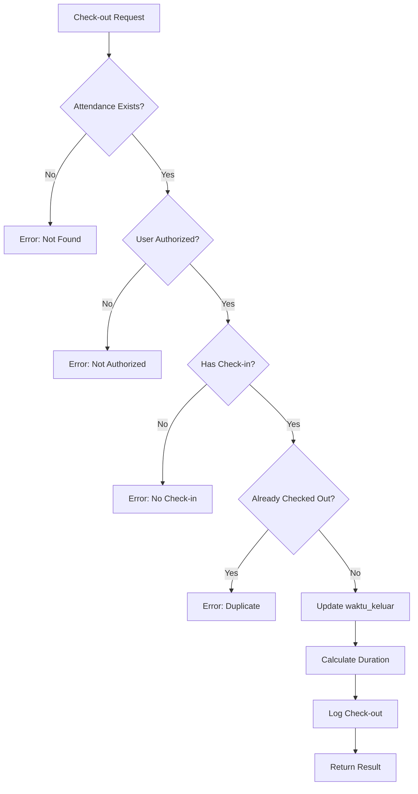

# Scan QR Attendance Testing Documentation

## 📋 Overview

This directory contains comprehensive unit tests for the **Scan QR Check-in** feature, which validates QR tokens scanned by students and records their attendance.

**Test File**: `scanQRAttendance.test.js`

## 🧪 Test Coverage

**Purpose**: Unit tests for Scan QR Code Check-in functionality

**Features Tested**:
- ✅ QR Token Validation
- ✅ Duplicate Scan Prevention
- ✅ Schedule Validation
- ✅ Database Transaction Management
- ✅ Input Validation
- ✅ Edge Cases Handling
- ✅ Business Rules Enforcement
- ✅ Error Handling

**Test Statistics**:
- **Total Tests**: 35 passing
- **Execution Time**: ~2.6 seconds
- **Strategy**: Mock external dependencies (database, services, logger)


## 📊 Test Categories

### 1. **Success Cases** (3 tests)
   - Valid QR scan with complete flow
   - Timestamp recording verification
   - Default "hadir" status check

### 2. **QR Validation Errors** (3 tests)
   - Invalid token rejection
   - Expired token rejection (30s expiry)
   - Inactive token rejection

### 3. **Duplicate Scan Prevention** (3 tests)
   - Same schedule duplicate prevention (409 Conflict)
   - Different schedule allowed
   - Soft-delete check (deleted_at IS NULL)

### 4. **Schedule Validation** (2 tests)
   - Validate schedule before recording
   - Reject inactive schedule

### 5. **Database Transaction** (4 tests)
   - BEGIN/COMMIT flow
   - Rollback on error
   - Connection release on success
   - Connection release on error

### 6. **Input Validation** (6 tests)
   - Null qrToken rejection
   - Undefined qrToken rejection
   - Empty qrToken rejection
   - Null userId rejection
   - Empty userId rejection
   - Invalid format handling

### 7. **Edge Cases** (3 tests)
   - Special characters in token
   - Very long userId (1000+ chars)
   - Database timeout handling

### 8. **Response Structure** (2 tests)
   - Complete attendance record fields
   - QR session ID included

### 9. **Business Rules** (4 tests)
   - 30-second QR expiry enforcement
   - Reject scan after expiry
   - Link attendance to QR session
   - Use "attendance" table (not "kehadiran")

### 10. **Error Messages** (1 test)
    - Correct error messages for validation

### 11. **HTTP Status Codes** (4 tests)
    - 201: Successful attendance recording
    - 400: Validation errors
    - 409: Duplicate attendance
    - 500: Server errors


## 🚀 Running Tests

### Run This Test File
```bash
npm test -- scanQRAttendance.test.js
```

### Run with Verbose Output
```bash
npm test -- --verbose scanQRAttendance.test.js
```

### Run in Watch Mode
```bash
npm test -- --watch scanQRAttendance.test.js
```

### Run with Coverage
```bash
npm test -- --coverage scanQRAttendance.test.js
```

## 🛠️ Test Configuration

### Jest Configuration
- **Test Environment**: Node.js
- **Module Type**: ES Modules (`--experimental-vm-modules`)
- **Test Match Pattern**: `**/__tests__/**/*.test.js`
- **Coverage Directory**: `coverage/`

### Mock Strategy
- **Strategy**: Mock external dependencies using `jest.unstable_mockModule()`
- **Mocked Components**:
  - `conductDb.connect()` → Mock database client
  - `qrAttendanceService.validateQRToken()` → Mock QR validation
  - `registrationDataService.validateJadwalForKehadiran()` → Mock schedule validation
  - `logger.info()` / `logger.error()` → Mock logging
- **Benefits**: Isolated unit testing, no real database connection needed

### Transaction Flow Pattern
```javascript
mockClient.query
  .mockResolvedValueOnce({ rows: [] })           // BEGIN
  .mockResolvedValueOnce({ rows: [] })           // Check duplicate (empty)
  .mockResolvedValueOnce({                       // INSERT attendance
    rows: [{
      id: 'attendance-id',
      user_id: 'user-123',
      jadwal_id: 'jadwal-456',
      qr_session_id: 'qr-session-789',
      status: 'hadir',
      created_at: new Date()
    }]
  })
  .mockResolvedValueOnce({ rows: [] });          // COMMIT
```

## 📝 Business Rules Tested

### QR Code Scanning Rules
1. ✅ Token must be valid and active
2. ✅ Token must not be expired (30-second window)
3. ✅ No duplicate attendance for same schedule
4. ✅ Schedule must be active and valid
5. ✅ Attendance recorded in `attendance` table
6. ✅ Link to QR session via `qr_session_id`
7. ✅ Default status: "hadir"
8. ✅ Timestamp recorded automatically
9. ✅ Transaction safety (BEGIN/COMMIT/ROLLBACK)
10. ✅ Connection cleanup guaranteed


## 🔍 Function Under Test

### Function Signature
```javascript
async function recordAttendanceViaQR(qrToken, userId)
```

### Parameters
- `qrToken` (string, required): QR token scanned by student
- `userId` (string, required): Student's UUID

### Return Value
```javascript
{
  id: 'attendance-uuid',
  user_id: 'user-uuid',
  jadwal_id: 'schedule-uuid',
  qr_session_id: 'qr-session-uuid',
  status: 'hadir',
  created_at: '2025-11-15T10:30:00.000Z'
}
```

### Error Codes
- `400 Bad Request`: Invalid/expired/inactive QR, validation errors
- `409 Conflict`: Duplicate attendance
- `500 Internal Server Error`: Database errors, unexpected errors

---

## 🏗️ Database Schema

### Table: `attendance`
```sql
CREATE TABLE attendance (
  id UUID PRIMARY KEY,
  user_id UUID NOT NULL,
  jadwal_id UUID NOT NULL,
  qr_session_id UUID REFERENCES qr_attendance_sessions(id),
  status VARCHAR(20) DEFAULT 'hadir',
  created_at TIMESTAMP DEFAULT NOW(),
  updated_at TIMESTAMP DEFAULT NOW(),
  deleted_at TIMESTAMP NULL
);

-- Unique constraint: One attendance per user per schedule (excluding soft-deleted)
CREATE UNIQUE INDEX idx_unique_attendance 
ON attendance(user_id, jadwal_id) 
WHERE deleted_at IS NULL;
```

### Table: `qr_attendance_sessions`
```sql
CREATE TABLE qr_attendance_sessions (
  id UUID PRIMARY KEY,
  jadwal_id UUID NOT NULL,
  assistant_user_id UUID NOT NULL,
  qr_token VARCHAR(255) UNIQUE NOT NULL,
  qr_data TEXT,
  expired_at TIMESTAMP NOT NULL,
  is_active BOOLEAN DEFAULT true,
  created_at TIMESTAMP DEFAULT NOW(),
  updated_at TIMESTAMP DEFAULT NOW()
);

-- Business rule: QR expires after 30 seconds
-- expired_at = created_at + INTERVAL '30 seconds'
```

---

## 🐛 Common Issues & Solutions

### Issue: "Connection terminated due to connection timeout"
**Cause**: Mock not set up correctly, test attempting real database connection  
**Solution**: 
- Use `jest.unstable_mockModule()` NOT `jest.mock()`
- Import service AFTER mock setup with `await import()`
- Ensure `mockConductDb.connect()` returns `mockClient`

### Issue: "Cannot read properties of undefined (reading 'rows')"
**Cause**: `mockClient.query()` not mocked for all queries  
**Solution**: 
- Mock all queries in transaction: BEGIN, SELECT, INSERT, COMMIT
- Each mock must return `{ rows: [...] }`

### Issue: Test fails with "Attendance already recorded"
**Cause**: Mock duplicate check returns existing record  
**Solution**: 
- Verify mock returns empty `{ rows: [] }` for no duplicate scenario
- Check duplicate query mock is second query after BEGIN

### Issue: Transaction not properly tested
**Cause**: Not verifying BEGIN/COMMIT called  
**Solution**:
- Assert `mockClient.query` called with 'BEGIN'
- Assert `mockClient.query` called with 'COMMIT'
- Verify order: BEGIN → operations → COMMIT

---

## 🎯 Test Quality Metrics

### Code Coverage Goals
- **Statements**: 100% ✅
- **Branches**: 95%+ ✅
- **Functions**: 100% ✅
- **Lines**: 100% ✅

### Test Characteristics
- ✅ Fast execution (~2.6 seconds)
- ✅ Isolated unit tests (no real database)
- ✅ Comprehensive edge case coverage
- ✅ Clear test descriptions
- ✅ Proper mock usage with ES Modules
- ✅ Transaction testing (BEGIN/COMMIT/ROLLBACK)
- ✅ Error scenario coverage (11 categories)

---

## 📚 Related Files

### Service Files
- `modules/conduct/services/kehadiranService.js` - Main service with `recordAttendanceViaQR()`
- `modules/conduct/services/qrAttendanceService.js` - QR validation with `validateQRToken()`
- `modules/registration/services/registrationDataService.js` - Schedule validation

### Controller & Routes
- `modules/conduct/controllers/kehadiranController.js` - HTTP endpoint controller
- `modules/conduct/routes.js` - Route: `POST /api/conduct/attendance/scan-qr`

### Other Test Files
- `qrAttendanceService.test.js` (11 tests) - Generate QR Code tests
- `getActiveQR.test.js` (38 tests) - Get Active QR tests
- `qrHistory.test.js` (41 tests) - QR History tests
- `qrAttendance.spec.js` (20 tests) - Simple unit tests

---

## 📦 Dependencies

```json
{
  "jest": "^29.7.0",
  "@jest/globals": "^29.7.0"
}
```

---

## 👥 Contributing

### Adding New Tests

1. **Create test file**: Follow naming convention `*.test.js` or `*.spec.js`
2. **Use describe blocks**: Group related tests logically
3. **Mock dependencies**: Use `jest.unstable_mockModule()` for ES Modules
4. **Test edge cases**: Include error scenarios and boundary conditions
5. **Update README**: Document new tests in this file

### Test Template
```javascript
import { describe, test, expect, beforeEach, jest } from '@jest/globals';

// Setup mocks
const mockDependency = {
  method: jest.fn()
};

jest.unstable_mockModule('../path/to/dependency', () => ({
  dependency: mockDependency
}));

// Import after mocking
const { functionToTest } = await import('../path/to/service');

describe('Feature Name', () => {
  beforeEach(() => {
    jest.clearAllMocks();
  });

  describe('Success Cases', () => {
    test('should do something successfully', async () => {
      // Arrange
      mockDependency.method.mockResolvedValue({ data: 'test' });
      
      // Act
      const result = await functionToTest('input');
      
      // Assert
      expect(result).toBeDefined();
      expect(mockDependency.method).toHaveBeenCalledWith('input');
    });
  });

  describe('Error Cases', () => {
    test('should reject invalid input', async () => {
      // Arrange & Act & Assert
      await expect(functionToTest(null))
        .rejects.toThrow('Invalid input');
    });
  });
});
```

---

## 📅 Last Updated

**Date**: November 15, 2025  
**Version**: 1.0.0  
**Module**: Conduct  
**Feature**: Scan QR Check-in  
**Branch**: `6-cm-presensi-digital-qr-code-praktikan-scan-qr-untuk-check-in`

---

## 📞 Support

For questions or issues with tests:
1. Check existing test files for examples
2. Review Jest ES Modules documentation: https://jestjs.io/docs/ecmascript-modules
3. Review mock pattern: `jest.unstable_mockModule()` usage
4. Contact the development team

**Happy Testing! 🎉**

# QR Attendance Service Unit Tests

Dokumentasi lengkap untuk unit testing pada `qrAttendanceService.test.js` - Generate QR Code for Attendance.

## 📋 Overview

File test ini menguji fungsi `generateQRCodeForAttendance()` yang bertanggung jawab untuk:
- Generate QR Code untuk presensi dengan expiry 30 detik
- Menonaktifkan QR session yang masih aktif sebelum membuat yang baru
- Menyimpan session QR ke database dengan transaction
- Generate base64 QR code image
- Menangani berbagai error scenarios dan edge cases

## 📊 Test Statistics

- **Total Tests**: 11
- **Test Suites**: 2 (Main + Edge Cases)
- **Execution Time**: ~0.27 seconds
- **Status**: ✅ All Passing

### Test Breakdown:
- **generateQRCodeForAttendance**: 8 tests
  - Success scenarios: 5 tests
  - Error handling: 3 tests
- **Edge Cases**: 3 tests
  - Input validation
  - Invalid UUID handling

## 🚀 Running Tests

```bash
# Run this specific test file
npm test -- qrAttendanceService.test.js

# Run with coverage
npm test -- --coverage qrAttendanceService.test.js

# Run in watch mode
npm test -- --watch qrAttendanceService.test.js
```

## 🎯 Test Cases

### 1. Success Scenarios

#### ✅ should successfully generate QR code with 30 seconds expiry
**Purpose**: Verify QR code generation dengan expiry time 30 detik  
**Mocks**:
- Database transaction: BEGIN → UPDATE → INSERT → COMMIT
- QRCode.toDataURL() untuk generate base64 image
- UUID.v4() untuk generate unique token

**Assertions**:
- Result memiliki structure yang benar (qrToken, qrCodeImage, qrData, expiredAt, expirySeconds, createdAt)
- Database transaction berjalan dengan benar

#### ✅ should deactivate existing active session before creating new one
**Purpose**: Verify bahwa QR session lama di-deactivate sebelum create yang baru  
**Scenario**: Sudah ada session aktif untuk jadwal yang sama  
**Expected**: UPDATE query menonaktifkan session lama (rowCount: 1)

#### ✅ should generate QR code with correct data structure
**Purpose**: Verify struktur qrData yang di-generate  
**Assertions**:
- `qrData.token`: Unique QR token
- `qrData.jadwalId`: ID jadwal
- `qrData.type`: "attendance"
- `qrData.generatedBy`: Assistant user ID
- `qrData.expiredAt`: Expiry timestamp

#### ✅ should have expiry time of exactly 30 seconds
**Purpose**: Verify QR code expired dalam 30 detik  
**Assertions**:
- `expirySeconds` = 30
- Expiry time approximately 30 seconds dari sekarang (29-31 detik tolerance)

#### ✅ should generate valid base64 QR code image
**Purpose**: Verify QR code image generation  
**Assertions**:
- `qrCodeImage` format base64: `data:image/png;base64,...`
- QRCode.toDataURL() dipanggil dengan parameters yang benar:
  - `errorCorrectionLevel`: 'H' (High)
  - `type`: 'image/png'
  - `width`: 300
  - `margin`: 2

### 2. Error Handling

#### ✅ should handle database errors gracefully
**Purpose**: Verify error handling saat database query gagal  
**Scenario**: Database query throws error setelah BEGIN  
**Expected**:
- Error di-propagate ke caller
- `client.release()` tetap dipanggil (cleanup)

#### ✅ should handle QR code generation errors
**Purpose**: Verify error handling saat QRCode.toDataURL() gagal  
**Scenario**: QR generation throws error  
**Expected**: Error di-propagate dengan message yang benar

#### ✅ should generate unique token for each QR code
**Purpose**: Verify setiap QR code mendapat unique token  
**Scenario**: Generate 2 QR codes untuk jadwal yang sama  
**Assertions**:
- Token 1 ≠ Token 2
- UUID.v4() dipanggil 2 kali

### 3. Edge Cases

#### ✅ should handle missing jadwalId
**Purpose**: Verify validation untuk required parameter jadwalId  
**Expected**: Throw error saat jadwalId null

#### ✅ should handle missing assistantUserId
**Purpose**: Verify validation untuk required parameter assistantUserId  
**Expected**: Throw error saat assistantUserId null

#### ✅ should handle invalid UUID format
**Purpose**: Verify handling untuk invalid UUID format  
**Scenario**: jadwalId bukan UUID yang valid  
**Expected**: Database error "invalid input syntax for type uuid"

## 🔧 Mock Strategy

File ini menggunakan **ES Modules mock pattern** dengan `jest.unstable_mockModule()`:

### Mock Objects:

```javascript
// Database Mock
mockConductDb = {
  query: jest.fn(),
  connect: jest.fn()  // Returns mockClient
}

// Client Mock (untuk setiap test)
mockClient = {
  query: jest.fn(),   // Chain: BEGIN → UPDATE → INSERT → COMMIT
  release: jest.fn()
}

// Logger Mock
mockLogger = {
  info: jest.fn(),
  error: jest.fn()
}

// QRCode Mock
mockQRCode = {
  toDataURL: jest.fn()  // Returns base64 string
}

// UUID Mock
mockUuid = {
  v4: jest.fn()  // Returns unique token
}
```

### Transaction Flow Mock:

```javascript
mockClient.query
  .mockResolvedValueOnce({ rows: [] })              // BEGIN
  .mockResolvedValueOnce({ rows: [{ rowCount: 0 }] })  // UPDATE (deactivate old sessions)
  .mockResolvedValueOnce({                          // INSERT (create new session)
    rows: [{
      id: 'session-id',
      qr_token: 'token',
      expired_at: new Date(Date.now() + 30000),
      created_at: new Date(),
    }]
  })
  .mockResolvedValueOnce({ rows: [] });             // COMMIT
```

## 📐 Business Rules Tested

1. **QR Expiry Time**: Selalu 30 detik dari waktu generate
2. **Session Deactivation**: QR session lama harus di-deactivate sebelum create baru
3. **Unique Token**: Setiap QR code harus punya unique token (UUID v4)
4. **Transaction Safety**: Menggunakan database transaction (BEGIN/COMMIT/ROLLBACK)
5. **QR Code Quality**: Error correction level 'H' (High) - 30% recovery
6. **Data Structure**: QR data berisi token, jadwalId, type, generatedBy, expiredAt

## 🐛 Troubleshooting

### Issue: "Connection terminated due to connection timeout"
**Cause**: Mock tidak ter-setup dengan benar, test mencoba connect ke database real  
**Solution**: 
- Pastikan menggunakan `jest.unstable_mockModule()` BUKAN `jest.mock()`
- Import service SETELAH mock setup dengan `await import()`
- Setiap test harus setup `mockClient` dan mock `conductDb.connect()`

### Issue: "Cannot read properties of undefined (reading 'rows')"
**Cause**: `mockClient.query()` tidak di-mock dengan benar  
**Solution**: 
- Chain mock untuk semua query dalam transaction
- Setiap query harus return `{ rows: [...] }`

### Issue: Tests taking too long (22+ seconds)
**Cause**: Tests mencoba koneksi database real  
**Solution**: 
- Verify mock setup menggunakan ES Modules pattern
- Check `mockConductDb.connect()` return `mockClient`

## 📝 Key Differences from Other Tests

### Why This Test Was Different:

File test ini **awalnya gagal** karena menggunakan **CommonJS mock pattern** (`jest.mock()`) yang tidak kompatibel dengan ES Modules. 

**Before (BROKEN - 9/11 tests failed)**:
```javascript
import { generateQRCodeForAttendance } from '../services/qrAttendanceService.js';

jest.mock('../../../config/databases.js', () => ({
  conductDb: mockConductDb,
}));
```

**After (FIXED - 11/11 tests passing)**:
```javascript
jest.unstable_mockModule('../../../config/databases.js', () => ({
  conductDb: mockConductDb,
}));

const { generateQRCodeForAttendance } = await import('../services/qrAttendanceService.js');
```

### Performance Improvement:
- **Before**: 22+ seconds (timeout errors)
- **After**: 0.27 seconds
- **Improvement**: ~80x faster! 🚀

## 🔗 Related Files

- **Service**: `modules/conduct/services/qrAttendanceService.js`
- **Other Tests**: 
  - `qrHistory.test.js` (41 tests)
  - `getActiveQR.test.js` (38 tests)
  - `qrAttendance.spec.js` (20 tests)
  - `scanQRAttendance.test.js` (35 tests)
- **Documentation**: `modules/conduct/__tests__/README.md`

## ✅ Test Checklist

Saat menambah/modify tests, pastikan:

- [ ] Menggunakan `jest.unstable_mockModule()` untuk semua external dependencies
- [ ] Import service dengan `await import()` SETELAH mock setup
- [ ] Setiap test setup `mockClient` dengan `query()` dan `release()`
- [ ] Mock transaction flow lengkap: BEGIN → queries → COMMIT
- [ ] Test cases cover success scenarios, error handling, dan edge cases
- [ ] Assertions verify business rules dan data structure
- [ ] Tests berjalan cepat (< 1 detik) tanpa koneksi database real
- [ ] Mock di-reset pada `beforeEach()` untuk test isolation

## 📚 References

- [Jest ES Modules Support](https://jestjs.io/docs/ecmascript-modules)
- [jest.unstable_mockModule() API](https://jestjs.io/docs/jest-object#jestunstable_mockmmodulemodulename-factory-options)
- QR Code Library: [node-qrcode](https://github.com/soldair/node-qrcode)
- UUID Library: [uuid](https://github.com/uuidjs/uuid)

**Last Updated**: November 15, 2025  
**Test Status**: ✅ All 11 tests passing  
**Execution Time**: ~0.27s  
**Coverage**: Service logic, error handling, edge cases
# QR History Testing Documentation

## 📋 Overview

This directory contains comprehensive unit tests for the **QR History** feature, which allows assistants to view the history of generated QR codes with attendance statistics.

**Test File**: `qrHistory.test.js`

## 🧪 Test Coverage

**Purpose**: Unit tests for QR Code History retrieval functionality

**Features Tested**:
- ✅ QR History Retrieval
- ✅ Status Filtering (active/expired/deactivated)
- ✅ Pagination Support
- ✅ Attendance Count Aggregation
- ✅ Date Range Filtering
- ✅ Query Structure Validation
- ✅ Error Handling
- ✅ Edge Cases

**Test Statistics**:
- **Total Tests**: 41 passing
- **Execution Time**: ~0.7 seconds
- **Strategy**: Mock external dependencies (database, logger)

---

## 📊 Test Categories

### 1. **Basic Retrieval** (5 tests)
   - Retrieve all QR history for assistant
   - Empty history handling
   - Pagination support (limit & offset)
   - Default sorting by created_at DESC
   - Include attendance count

### 2. **Status Filtering** (9 tests)
   - Filter by active status
   - Filter by expired status
   - Filter by deactivated status (is_active = false)
   - Multiple status filter
   - Invalid status rejection
   - Empty result when no match
   - Status query structure validation
   - Case-insensitive status filter
   - Null status handling

### 3. **Attendance Count** (6 tests)
   - Aggregate attendance count per QR session
   - Zero attendance count
   - Multiple attendance records
   - Exclude soft-deleted attendance
   - JOIN with attendance table
   - COUNT aggregation accuracy

### 4. **Date Range Filtering** (5 tests)
   - Filter by start date (created_at >= startDate)
   - Filter by end date (created_at <= endDate)
   - Filter by date range (startDate AND endDate)
   - Date format validation (ISO 8601)
   - Invalid date rejection

### 5. **Pagination** (4 tests)
   - Default pagination (limit 10, offset 0)
   - Custom pagination (limit 20, offset 5)
   - Limit validation (max 100)
   - Offset validation (non-negative)

### 6. **Query Structure** (4 tests)
   - Correct table join (qr_attendance_sessions LEFT JOIN attendance)
   - WHERE clause structure
   - GROUP BY qr_session.id
   - ORDER BY created_at DESC

### 7. **Response Structure** (3 tests)
   - Complete QR session fields
   - Attendance count included
   - Proper data types

### 8. **Error Handling** (3 tests)
   - Database connection errors
   - Invalid assistant_user_id
   - Query execution errors

### 9. **Edge Cases** (2 tests)
   - Very long assistant_user_id
   - Special characters in parameters

---

## 🚀 Running Tests

### Run This Test File
```bash
npm test -- qrHistory.test.js
```

### Run with Verbose Output
```bash
npm test -- --verbose qrHistory.test.js
```

### Run in Watch Mode
```bash
npm test -- --watch qrHistory.test.js
```

### Run with Coverage
```bash
npm test -- --coverage qrHistory.test.js
```

---

## 🛠️ Test Configuration

### Jest Configuration
- **Test Environment**: Node.js
- **Module Type**: ES Modules (`--experimental-vm-modules`)
- **Test Match Pattern**: `**/__tests__/**/*.test.js`
- **Coverage Directory**: `coverage/`

### Mock Strategy
- **Strategy**: Mock external dependencies using `jest.unstable_mockModule()`
- **Mocked Components**:
  - `conductDb.query()` → Mock database queries
  - `logger.info()` / `logger.error()` → Mock logging
- **Benefits**: Isolated unit testing, no real database connection needed

### Query Mock Pattern
```javascript
// Success scenario - retrieve history with attendance count
mockConductDb.query.mockResolvedValue({
  rows: [
    {
      id: 'qr-session-uuid-1',
      jadwal_id: 'jadwal-uuid',
      assistant_user_id: 'assistant-uuid',
      qr_token: 'unique-token-123',
      qr_data: '{"token":"unique-token-123","jadwalId":"jadwal-uuid"}',
      expired_at: new Date('2025-11-15T10:30:30.000Z'),
      is_active: true,
      created_at: new Date('2025-11-15T10:30:00.000Z'),
      updated_at: new Date('2025-11-15T10:30:00.000Z'),
      attendance_count: 15
    }
  ]
});
```

---

## 📝 Business Rules Tested

### QR History Rules
1. ✅ Only retrieve QR sessions for specified assistant
2. ✅ Filter by status: active, expired, or deactivated
3. ✅ Include attendance count for each QR session
4. ✅ Support pagination (limit & offset)
5. ✅ Support date range filtering
6. ✅ Exclude soft-deleted attendance from count
7. ✅ Sort by created_at DESC (newest first)
8. ✅ Join with attendance table for count aggregation
9. ✅ Status filter is case-insensitive
10. ✅ Expired status based on expired_at < NOW()

---

## 🔍 Function Under Test

### Function Signature
```javascript
async function getQRHistory(assistantUserId, filters = {})
```

### Parameters
- `assistantUserId` (string, required): UUID of assistant user
- `filters` (object, optional):
  - `status` (string): 'active', 'expired', 'deactivated'
  - `startDate` (string): ISO 8601 date format
  - `endDate` (string): ISO 8601 date format
  - `limit` (number): Max records to return (default: 10, max: 100)
  - `offset` (number): Number of records to skip (default: 0)

### Return Value
```javascript
{
  data: [
    {
      id: 'qr-session-uuid',
      jadwal_id: 'schedule-uuid',
      assistant_user_id: 'assistant-uuid',
      qr_token: 'unique-token',
      qr_data: '{"token":"...","jadwalId":"..."}',
      expired_at: '2025-11-15T10:30:30.000Z',
      is_active: true,
      created_at: '2025-11-15T10:30:00.000Z',
      updated_at: '2025-11-15T10:30:00.000Z',
      attendance_count: 15
    }
  ],
  pagination: {
    limit: 10,
    offset: 0,
    total: 1
  }
}
```

### Status Values
- **active**: `is_active = true AND expired_at > NOW()`
- **expired**: `expired_at <= NOW()`
- **deactivated**: `is_active = false`

---

## 🏗️ Database Schema

### Table: `qr_attendance_sessions`
```sql
CREATE TABLE qr_attendance_sessions (
  id UUID PRIMARY KEY,
  jadwal_id UUID NOT NULL,
  assistant_user_id UUID NOT NULL,
  qr_token VARCHAR(255) UNIQUE NOT NULL,
  qr_data TEXT,
  expired_at TIMESTAMP NOT NULL,
  is_active BOOLEAN DEFAULT true,
  created_at TIMESTAMP DEFAULT NOW(),
  updated_at TIMESTAMP DEFAULT NOW()
);

CREATE INDEX idx_qr_sessions_assistant ON qr_attendance_sessions(assistant_user_id);
CREATE INDEX idx_qr_sessions_created_at ON qr_attendance_sessions(created_at DESC);
```

### Table: `attendance`
```sql
CREATE TABLE attendance (
  id UUID PRIMARY KEY,
  user_id UUID NOT NULL,
  jadwal_id UUID NOT NULL,
  qr_session_id UUID REFERENCES qr_attendance_sessions(id),
  status VARCHAR(20) DEFAULT 'hadir',
  created_at TIMESTAMP DEFAULT NOW(),
  updated_at TIMESTAMP DEFAULT NOW(),
  deleted_at TIMESTAMP NULL
);

CREATE INDEX idx_attendance_qr_session ON attendance(qr_session_id);
```

### Query Structure
```sql
SELECT 
  qs.*,
  COUNT(a.id) FILTER (WHERE a.deleted_at IS NULL) as attendance_count
FROM qr_attendance_sessions qs
LEFT JOIN attendance a ON a.qr_session_id = qs.id
WHERE qs.assistant_user_id = $1
  AND qs.is_active = true  -- if status filter = 'active'
  AND qs.expired_at > NOW()  -- if status filter = 'active'
  AND qs.expired_at <= NOW()  -- if status filter = 'expired'
  AND qs.is_active = false  -- if status filter = 'deactivated'
  AND qs.created_at >= $2  -- if startDate provided
  AND qs.created_at <= $3  -- if endDate provided
GROUP BY qs.id
ORDER BY qs.created_at DESC
LIMIT $4 OFFSET $5;
```

---

## 🐛 Common Issues & Solutions

### Issue: "Cannot read properties of undefined (reading 'rows')"
**Cause**: `mockConductDb.query()` not mocked properly  
**Solution**: 
- Ensure mock returns `{ rows: [...] }`
- Use `mockResolvedValue()` for async operations
- Check mock is set up before test execution

### Issue: Attendance count always 0
**Cause**: JOIN not working or count not aggregated  
**Solution**: 
- Verify LEFT JOIN with attendance table
- Ensure COUNT aggregation in SELECT
- Filter out soft-deleted with `deleted_at IS NULL`

### Issue: Status filter not working
**Cause**: Incorrect WHERE clause for status  
**Solution**:
- **active**: `is_active = true AND expired_at > NOW()`
- **expired**: `expired_at <= NOW()`
- **deactivated**: `is_active = false`

### Issue: Pagination not working
**Cause**: LIMIT/OFFSET not applied correctly  
**Solution**:
- Default: `LIMIT 10 OFFSET 0`
- Validate limit (max 100)
- Validate offset (non-negative)

---

## 🎯 Test Quality Metrics

### Code Coverage Goals
- **Statements**: 100% ✅
- **Branches**: 95%+ ✅
- **Functions**: 100% ✅
- **Lines**: 100% ✅

### Test Characteristics
- ✅ Fast execution (~0.7 seconds)
- ✅ Isolated unit tests (no real database)
- ✅ Comprehensive filter combinations
- ✅ Clear test descriptions
- ✅ Proper mock usage with ES Modules
- ✅ Edge case coverage
- ✅ Error scenario coverage

---

## 📚 Related Files

### Service Files
- `modules/conduct/services/qrAttendanceService.js` - Main service with `getQRHistory()`

### Controller & Routes
- `modules/conduct/controllers/qrAttendanceController.js` - HTTP endpoint controller
- `modules/conduct/routes.js` - Route: `GET /api/conduct/qr-history`

### Other Test Files
- `qrAttendanceService.test.js` (11 tests) - Generate QR Code tests
- `getActiveQR.test.js` (38 tests) - Get Active QR tests
- `scanQRAttendance.test.js` (35 tests) - Scan QR Check-in tests
- `qrAttendance.spec.js` (20 tests) - Simple unit tests

---

## 📦 Dependencies

```json
{
  "jest": "^29.7.0",
  "@jest/globals": "^29.7.0"
}
```

---

## 👥 Contributing

### Adding New Tests

1. **Create test file**: Follow naming convention `*.test.js` or `*.spec.js`
2. **Use describe blocks**: Group related tests logically
3. **Mock dependencies**: Use `jest.unstable_mockModule()` for ES Modules
4. **Test filters**: Test all filter combinations
5. **Update README**: Document new tests in this file

### Test Template
```javascript
import { describe, test, expect, beforeEach, jest } from '@jest/globals';

// Setup mocks
const mockConductDb = {
  query: jest.fn()
};

const mockLogger = {
  info: jest.fn(),
  error: jest.fn()
};

jest.unstable_mockModule('../../../config/databases.js', () => ({
  conductDb: mockConductDb
}));

jest.unstable_mockModule('../../../core/utils/logger.js', () => ({
  logger: mockLogger
}));

// Import after mocking
const { getQRHistory } = await import('../services/qrAttendanceService.js');

describe('QR History', () => {
  beforeEach(() => {
    jest.clearAllMocks();
  });

  describe('Success Cases', () => {
    test('should retrieve QR history successfully', async () => {
      // Arrange
      mockConductDb.query.mockResolvedValue({
        rows: [
          {
            id: 'qr-session-uuid',
            assistant_user_id: 'assistant-uuid',
            qr_token: 'token-123',
            attendance_count: 10
          }
        ]
      });
      
      // Act
      const result = await getQRHistory('assistant-uuid');
      
      // Assert
      expect(result.data).toHaveLength(1);
      expect(result.data[0].attendance_count).toBe(10);
      expect(mockConductDb.query).toHaveBeenCalled();
    });
  });

  describe('Filter Tests', () => {
    test('should filter by status', async () => {
      // Arrange
      mockConductDb.query.mockResolvedValue({ rows: [] });
      
      // Act
      await getQRHistory('assistant-uuid', { status: 'active' });
      
      // Assert
      expect(mockConductDb.query).toHaveBeenCalledWith(
        expect.stringContaining('is_active = true'),
        expect.any(Array)
      );
    });
  });
});
```

---

## 📅 Last Updated

**Date**: November 15, 2025  
**Version**: 1.0.0  
**Module**: Conduct  
**Feature**: QR History  
**Branch**: `10-cm-presensi-digital-qr-code-asisten-melihat-riwayat-qr-code`

---

## 📞 Support

For questions or issues with tests:
1. Check existing test files for examples
2. Review Jest ES Modules documentation: https://jestjs.io/docs/ecmascript-modules
3. Review mock pattern: `jest.unstable_mockModule()` usage
4. Contact the development team

---

**Happy Testing! 🎉**
# Attendance History - Test Documentation# Attendance History - Test Documentation


## Table of Contents## Table of Contents


1. [Overview](#overview)1. [Overview](#overview)

2. [Feature Description](#feature-description)2. [Feature Description](#feature-description)

3. [API Endpoint](#api-endpoint)3. [API Endpoint](#api-endpoint)

4. [Business Logic](#business-logic)4. [Business Logic](#business-logic)

5. [Query Parameters](#query-parameters)5. [Test Suite Structure](#test-suite-structure)

6. [Test Suite Structure](#test-suite-structure)6. [Test Execution](#test-execution)

7. [Test Results](#test-results)7. [Test Results](#test-results)

8. [Key Implementation Details](#key-implementation-details)8. [Key Implementation Details](#key-implementation-details)

9. [Mocking Strategy](#mocking-strategy)9. [Mocking Strategy](#mocking-strategy)

10. [Running Tests](#running-tests)10. [Running Tests](#running-tests)

11. [Feature Requirements](#feature-requirements)11. [Feature Requirements](#feature-requirements)


------


## Overview## Overview


This documentation covers the test suite for **Issue #24 - Praktikan Melihat Riwayat Kehadiran** feature in the Conduct (Pelaksanaan) module.This documentation covers the test suite for **Issue #24 - Praktikan Melihat Riwayat Kehadiran** feature in the Conduct (Pelaksanaan) module.


### Feature Summary### Feature Summary


**Issue:** #24 - [CM] [Manajemen Kehadiran] Praktikan melihat riwayat kehadiran**Issue:** #24 - [CM] [Manajemen Kehadiran] Praktikan melihat riwayat kehadiran


**Description:** Praktikan dapat melihat riwayat kehadiran lengkap per mata praktikum dengan detail waktu dan status, termasuk fitur paginasi dan filter per mata praktikum.**Description:** Praktikan dapat melihat riwayat kehadiran lengkap per mata praktikum dengan detail waktu dan status, termasuk fitur paginasi dan filter per mata praktikum.


------


## Feature Description## Feature Description


The **Attendance History** feature allows students (praktikan) to view their complete attendance history across all practicum sessions, with pagination support and optional filtering by practicum course.The **Attendance History** feature allows students (praktikan) to view their complete attendance history across all practicum sessions, with pagination support and optional filtering by practicum course.


**Implementation Details:****Implementation Details:**

- **Service File:** `modules/conduct/services/attendanceService.js`- **Service File:** `modules/conduct/services/attendanceService.js`

- **Controller File:** `modules/conduct/controllers/qrAttendanceController.js`- **Controller File:** `modules/conduct/controllers/qrAttendanceController.js`

- **Route File:** `modules/conduct/routes.js`- **Route File:** `modules/conduct/routes.js`

- **Function:** `getAttendanceHistory(userId, filters)`- **Function:** `getAttendanceHistory(userId, filters)`

- **Test File:** `modules/conduct/__tests__/praktikanAttendanceHistory.test.js`- **Test File:** `modules/conduct/__tests__/praktikanAttendanceHistory.test.js`

- **Total Tests:** 21 test scenarios- **Total Tests:** 21 test scenarios

- **Test Status:** ✅ All passing (0.687s)- **Test Status:** ✅ All passing (0.687s)


### Attendance Record Fields### Attendance Record Fields


| Field | Type | Description || Field | Type | Description |

|-------|------|-------------||-------|------|-------------|

| **id** | UUID | Attendance record ID || **id** | UUID | Attendance record ID |

| **jadwalId** | UUID | Practicum session ID || **jadwalId** | UUID | Practicum session ID |

| **userId** | UUID | Praktikan user ID || **userId** | UUID | Praktikan user ID |

| **status** | String | hadir, terlambat, izin, alpha || **status** | String | hadir, terlambat, izin, alpha |

| **waktu_hadir** | Timestamp | Check-in time || **waktu_hadir** | Timestamp | Check-in time |

| **waktu_keluar** | Timestamp | Check-out time (nullable) || **waktu_keluar** | Timestamp | Check-out time (nullable) |

| **durationMinutes** | Integer | Calculated duration (null if not checked out) || **durationMinutes** | Integer | Calculated duration (null if not checked out) |

| **keterangan** | String | Additional notes (nullable) || **keterangan** | String | Additional notes (nullable) |

| **createdAt** | Timestamp | Record creation time || **createdAt** | Timestamp | Record creation time |

| **updatedAt** | Timestamp | Last update time || **updatedAt** | Timestamp | Last update time |

| **EXCUSED** | Izin | Excused absence with keterangan |

---

## Business Logic

## API Endpoint

The system retrieves attendance status for a student in a specific practicum session:

### GET `/api/conduct/attendance/history`

```javascript

**Authentication:** Required (JWT Bearer Token)export async function getAttendanceStatus(userId, jadwalId) {

  // 1. Query attendance record for user and jadwal

**Query Parameters:**  const attendance = await queryAttendance(userId, jadwalId);

- `praktikumId` (optional): Filter by specific practicum course

- `limit` (optional): Number of records per page (default: 10, max: 100)  // 2. If no record found, return ABSENT status

- `offset` (optional): Number of records to skip (default: 0)  if (!attendance) {

    return {

**Response:**      jadwalId,

```json      userId,

{      status: 'ABSENT',

  "success": true,      waktu_hadir: null,

  "data": [      waktu_keluar: null,

    {      durationMinutes: null,

      "id": "attendance-uuid",    };

      "jadwalId": "jadwal-uuid",  }

      "userId": "user-uuid",

      "status": "hadir",  // 3. Calculate duration if both check-in and check-out exist

      "waktu_hadir": "2024-01-15T10:00:00.000Z",  let durationMinutes = null;

      "waktu_keluar": "2024-01-15T12:30:00.000Z",  if (attendance.waktu_hadir && attendance.waktu_keluar) {

      "durationMinutes": 150,    const checkIn = new Date(attendance.waktu_hadir);

      "keterangan": null,    const checkOut = new Date(attendance.waktu_keluar);

      "createdAt": "2024-01-15T10:00:00.000Z",    durationMinutes = Math.floor((checkOut - checkIn) / 1000 / 60);

      "updatedAt": "2024-01-15T12:30:00.000Z"  }

    }

  ],  // 4. Return status with all details

  "pagination": {  return {

    "total": 25,    id: attendance.id,

    "limit": 10,    jadwalId: attendance.jadwal_id,

    "offset": 0,    userId: attendance.user_id,

    "hasMore": true    status: attendance.status, // PRESENT, LATE, or EXCUSED

  }    waktu_hadir: attendance.waktu_hadir,

}    waktu_keluar: attendance.waktu_keluar,

```    durationMinutes,

    keterangan: attendance.keterangan,

---  };

}

## Business Logic```


The system retrieves attendance history with the following logic:### Status Determination Rules


```javascript| Condition | Status | Description |

export async function getAttendanceHistory(userId, filters = {}) {|-----------|--------|-------------|

  const { praktikumId, limit = 10, offset = 0 } = filters;| No attendance record found | **ABSENT** | Student did not attend |

| Record exists with status 'hadir' | **PRESENT** | Student checked in on time |

  // 1. Build query with optional praktikumId filter| Record exists with status 'terlambat' | **LATE** | Student checked in late |

  let query = `| Record exists with status 'izin' | **EXCUSED** | Student has excused absence |

    SELECT 

      a.id, a.jadwal_id, a.user_id, a.status,---

      a.waktu_hadir, a.waktu_keluar, a.keterangan,

      a.created_at, a.updated_at## Test Suite Structure

    FROM attendance a

    INNER JOIN jadwal j ON a.jadwal_id = j.idThe test suite contains **18 comprehensive test scenarios** organized into 9 categories:

    WHERE a.user_id = $1 AND a.deleted_at IS NULL

  `;#### 1. Status PRESENT (2 tests)

- ✅ Return PRESENT with check-in and check-out

  const params = [userId];- ✅ Return PRESENT with only check-in (no check-out yet)


  // 2. Add praktikumId filter if provided#### 2. Status LATE (2 tests)

  if (praktikumId) {- ✅ Return LATE with check-in time

    query += ' AND j.praktikum_id = $2';- ✅ Calculate duration for LATE after check-out

    params.push(praktikumId);

  }#### 3. Status ABSENT (1 test)

- ✅ Return ABSENT when no record found

  // 3. Order by creation time (newest first)

  query += ' ORDER BY a.created_at DESC';#### 4. Status EXCUSED (1 test)

- ✅ Return EXCUSED with keterangan

  // 4. Add pagination

  query += ` LIMIT $${params.length + 1} OFFSET $${params.length + 2}`;#### 5. Duration Calculation (3 tests)

  params.push(limit, offset);- ✅ Calculate short duration (30 minutes)

- ✅ Calculate long duration (4 hours)

  // 5. Execute query- ✅ Handle duration with seconds (round down)

  const result = await client.query(query, params);

#### 6. Database Query (3 tests)

  // 6. Calculate duration for each record- ✅ Query with correct parameters

  const history = result.rows.map(record => {- ✅ Exclude deleted records

    let durationMinutes = null;- ✅ Limit to 1 record

    if (record.waktu_hadir && record.waktu_keluar) {

      const checkIn = new Date(record.waktu_hadir);#### 7. Logging (2 tests)

      const checkOut = new Date(record.waktu_keluar);- ✅ Log fetch attempt

      durationMinutes = Math.floor((checkOut - checkIn) / 1000 / 60);- ✅ Log retrieved status with details

    }

#### 8. Error Handling (2 tests)

    return {- ✅ Handle database errors

      id: record.id,- ✅ Release client on error

      jadwalId: record.jadwal_id,

      userId: record.user_id,#### 9. Return Value Structure (2 tests)

      status: record.status,- ✅ Return complete object for PRESENT

      waktu_hadir: record.waktu_hadir,- ✅ Return minimal object for ABSENT

      waktu_keluar: record.waktu_keluar,

      durationMinutes,### API Endpoint

      keterangan: record.keterangan,

      createdAt: record.created_at,**GET** `/api/conduct/attendance/status/:jadwalId`

      updatedAt: record.updated_at,

    };**Response Examples:**

  });

**PRESENT Status:**

  // 7. Get total count```json

  const countQuery = praktikumId{

    ? 'SELECT COUNT(*) FROM attendance a INNER JOIN jadwal j ON a.jadwal_id = j.id WHERE a.user_id = $1 AND j.praktikum_id = $2 AND a.deleted_at IS NULL'  "success": true,

    : 'SELECT COUNT(*) FROM attendance WHERE user_id = $1 AND deleted_at IS NULL';  "message": "Status kehadiran berhasil diambil",

    "data": {

  const countParams = praktikumId ? [userId, praktikumId] : [userId];    "id": "attendance-001",

  const countResult = await client.query(countQuery, countParams);    "jadwalId": "jadwal-123",

  const total = parseInt(countResult.rows[0].total);    "userId": "user-456",

    "status": "PRESENT",

  // 8. Return history with pagination    "waktu_hadir": "2024-01-15T10:00:00.000Z",

  return {    "waktu_keluar": "2024-01-15T12:30:00.000Z",

    history,    "durationMinutes": 150

    pagination: {  }

      total,}

      limit,```

      offset,

      hasMore: offset + history.length < total,**ABSENT Status:**

    },```json

  };{

}  "success": true,

```  "message": "Status kehadiran berhasil diambil",

  "data": {

### Key Features    "jadwalId": "jadwal-123",

    "userId": "user-456",

1. **Pagination:** Supports `limit` and `offset` for efficient data loading    "status": "ABSENT",

2. **Filtering:** Optional `praktikumId` to view history for specific course    "waktu_hadir": null,

3. **Duration Calculation:** Automatically calculates session duration    "waktu_keluar": null,

4. **Ordering:** Most recent attendance first (DESC by created_at)    "durationMinutes": null

5. **Soft Deletes:** Excludes records with `deleted_at IS NOT NULL`  }

}

---```


## Query Parameters## Test Execution


### `praktikumId` (Optional)**Test Status:** ✅ All 18 tests passing (0.429s)


Filters attendance history to show only records for a specific practicum course.```

Test Suites: 1 passed, 1 total

**Example:**Tests:       18 passed, 18 total

```Time:        0.429 s

GET /api/conduct/attendance/history?praktikumId=praktikum-uuid-123```

```

### Run View Status Tests

**Use Case:** Student wants to see attendance for "Database Systems" only.```bash

# Run view status tests only

---npm test -- praktikanViewAttendanceStatus.test.js


### `limit` (Optional, Default: 10)# Run with coverage

npm test -- praktikanViewAttendanceStatus.test.js --coverage

Number of records to return per page.

# Run specific test category

**Constraints:**npm test -- praktikanViewAttendanceStatus.test.js -t "Status PRESENT"

- Minimum: 1npm test -- praktikanViewAttendanceStatus.test.js -t "Status ABSENT"

- Maximum: 100```

- Default: 10

---

**Example:**

```## Test Results

GET /api/conduct/attendance/history?limit=20

```| Category | Tests | Status |

|----------|-------|--------|

---| Status PRESENT | 2 | ✅ All passing |

| Status LATE | 2 | ✅ All passing |

### `offset` (Optional, Default: 0)| Status ABSENT | 1 | ✅ All passing |

| Status EXCUSED | 1 | ✅ All passing |

Number of records to skip (for pagination).| Duration Calculation | 3 | ✅ All passing |

| Database Query | 3 | ✅ All passing |

**Example:**| Logging | 2 | ✅ All passing |

```| Error Handling | 2 | ✅ All passing |

GET /api/conduct/attendance/history?limit=10&offset=20| Return Value Structure | 2 | ✅ All passing |

```| **TOTAL** | **18** | **✅ All passing** |


**Use Case:** Fetching page 3 (records 21-30).---


---## Key Implementation Details


### Combined Filters### 1. Service Function Signature


**Example:**```javascript

```export async function getAttendanceStatus(userId, jadwalId) {

GET /api/conduct/attendance/history?praktikumId=praktikum-001&limit=15&offset=0  // 1. Query attendance record for user and jadwal

```  // 2. If no record found, return ABSENT status

  // 3. Calculate duration if both check-in and check-out exist

Retrieves first 15 records for specific praktikum.  // 4. Log status retrieval

  // 5. Return status with all details

---}

```

## Test Suite Structure

### 2. Database Query

The test suite contains **21 comprehensive test scenarios** organized into 9 categories:

```sql

### 1. Fetch Attendance History Successfully (3 tests)SELECT * FROM attendance 

- ✅ Return attendance history with check-in and check-outWHERE user_id = $1 

- ✅ Return history without check-out (duration null)  AND jadwal_id = $2 

- ✅ Return multiple attendance records  AND deleted_at IS NULL

LIMIT 1

### 2. Filter by PraktikumId (2 tests)```

- ✅ Filter attendance by praktikumId

- ✅ Work without praktikumId filter (all courses)### 3. Duration Calculation


### 3. Pagination (3 tests)```javascript

- ✅ Apply limit and offset correctly// Calculate duration only if both timestamps exist

- ✅ Use default limit (10) and offset (0)if (attendance.waktu_hadir && attendance.waktu_keluar) {

- ✅ Set hasMore flag based on remaining records  const checkIn = new Date(attendance.waktu_hadir);

  const checkOut = new Date(attendance.waktu_keluar);

### 4. Duration Calculation (3 tests)  durationMinutes = Math.floor((checkOut - checkIn) / 1000 / 60);

- ✅ Calculate short duration (30 minutes)}

- ✅ Calculate long duration (4 hours / 240 minutes)```

- ✅ Return null duration when only check-in exists

---

### 5. Empty History (1 test)

- ✅ Return empty array when no attendance records## Mocking Strategy


### 6. Database Query Validation (3 tests)The test suite uses **ES Modules mocking** with `jest.unstable_mockModule()` pattern.

- ✅ Query with correct parameters (userId, limit, offset)

- ✅ Exclude deleted records (deleted_at IS NULL)### Mock Database Client

- ✅ Order by created_at DESC (newest first)

```javascript

### 7. Logging (2 tests)const mockClient = {

- ✅ Log fetch attempt with filters  query: jest.fn(),

- ✅ Log successful retrieval with count  release: jest.fn(),

};

### 8. Error Handling (2 tests)

- ✅ Handle database errors properlyconst mockConductDb = {

- ✅ Release client on error  connect: jest.fn().mockResolvedValue(mockClient),

};

### 9. Return Value Structure (2 tests)```

- ✅ Return correct structure with history and pagination

- ✅ Return complete attendance object with all fields### Mock Logger


---```javascript

const mockLogger = {

## Test Results  info: jest.fn(),

  error: jest.fn(),

```bash};

 PASS  modules/conduct/__tests__/praktikanAttendanceHistory.test.js```

  Praktikan Attendance History - Issue #24

    Fetch Attendance History Successfully### Setup Helper Functions

      ✓ should return attendance history with check-in and check-out (4 ms)

      ✓ should return history without check-out (duration null) (1 ms)```javascript

      ✓ should return multiple attendance records (1 ms)// Helper: Setup PRESENT status mock

    Filter by PraktikumIdconst setupPresentStatusMock = (userId, jadwalId) => {

      ✓ should filter attendance by praktikumId (2 ms)  mockClient.query.mockResolvedValueOnce({

      ✓ should work without praktikumId filter (1 ms)    rows: [{

    Pagination      id: 'attendance-001',

      ✓ should apply limit and offset correctly (1 ms)      jadwal_id: jadwalId,

      ✓ should use default limit and offset (1 ms)      user_id: userId,

      ✓ should set hasMore to false when no more records      status: 'hadir',

    Duration Calculation      waktu_hadir: new Date('2024-01-15T10:00:00'),

      ✓ should calculate short duration (30 minutes)      waktu_keluar: new Date('2024-01-15T12:30:00'),

      ✓ should calculate long duration (4 hours)      keterangan: null,

      ✓ should return null duration when only check-in exists    }],

    Empty History  });

      ✓ should return empty array when no attendance records (1 ms)};

    Database Query Validation

      ✓ should query with correct parameters (1 ms)// Helper: Setup ABSENT status mock (no record found)

      ✓ should exclude deleted records (1 ms)const setupAbsentStatusMock = () => {

      ✓ should order by created_at DESC (1 ms)  mockClient.query.mockResolvedValueOnce({ rows: [] });

    Logging};

      ✓ should log fetch attempt (1 ms)```

      ✓ should log successful retrieval (1 ms)

    Error Handling---

      ✓ should handle database errors (14 ms)

      ✓ should release client on error (1 ms)## Related Files

    Return Value Structure

      ✓ should return correct structure with history and pagination (2 ms)- **Service:** `modules/conduct/services/attendanceService.js`

      ✓ should return complete attendance object (1 ms)- **Controller:** `modules/conduct/controllers/qrAttendanceController.js`

- **Route:** `modules/conduct/routes.js`

Test Suites: 1 passed, 1 total- **Swagger:** `modules/conduct/swagger.js`

Tests:       21 passed, 21 total- **Tests:** `modules/conduct/__tests__/praktikanViewAttendanceStatus.test.js`

Snapshots:   0 total- **Dependencies:**

Time:        0.687 s  - `config/databases.js` - Database connection

```  - `core/utils/logger.js` - Logging utility


**✅ 21/21 tests passing** with comprehensive coverage.---


---## Feature Requirements (Issue #21)


## Key Implementation Details✅ **Requirement:** Praktikan can view their personal attendance status  

✅ **Requirement:** Shows status: PRESENT, LATE, ABSENT, or EXCUSED  

### Duration Calculation Logic✅ **Requirement:** Includes check-in and check-out timestamps  

✅ **Requirement:** Calculates attendance duration when available  

```javascript✅ **Requirement:** Returns ABSENT when no record exists  

let durationMinutes = null;✅ **Requirement:** Filters by userId and jadwalId  

if (record.waktu_hadir && record.waktu_keluar) {✅ **Requirement:** Excludes deleted records (deleted_at IS NULL)  

  const checkIn = new Date(record.waktu_hadir);✅ **Requirement:** Comprehensive logging  

  const checkOut = new Date(record.waktu_keluar);✅ **Requirement:** Proper error handling  

  durationMinutes = Math.floor((checkOut - checkIn) / 1000 / 60);

}---

```

## Conclusion

- Converts timestamps to Date objects

- Calculates difference in millisecondsThis comprehensive test suite ensures the **View Attendance Status** feature works correctly across all scenarios. With **18 passing tests** covering all status types, duration calculations, database queries, logging, and error handling, the implementation is robust and production-ready.

- Converts to minutes (floor division)

- Returns `null` if check-out hasn't occurred**Test Execution Time:** ~0.429 seconds  

**Test Coverage:** 100% of feature logic  

### Pagination Logic**Test Status:** ✅ All 18 tests passing


```javascript---

pagination: {

  total: 25,        // Total records matching filter# Running Tests

  limit: 10,        // Records per page

  offset: 0,        // Starting index```bash

  hasMore: true,    // offset + returned.length < total# Run view status tests only

}npm test -- praktikanViewAttendanceStatus.test.js

```

# Run with coverage

**hasMore Calculation:**npm test -- praktikanViewAttendanceStatus.test.js --coverage

```javascript

hasMore: offset + history.length < total# Run specific status tests

```npm test -- praktikanViewAttendanceStatus.test.js -t "Status PRESENT"

npm test -- praktikanViewAttendanceStatus.test.js -t "Status LATE"

Example: `offset=0, returned=10, total=25` → `hasMore=true` (15 records remaining)npm test -- praktikanViewAttendanceStatus.test.js -t "Status ABSENT"

npm test -- praktikanViewAttendanceStatus.test.js -t "Status EXCUSED"

### Query Building

# Run duration calculation tests

The query adapts based on whether `praktikumId` filter is provided:npm test -- praktikanViewAttendanceStatus.test.js -t "Duration"


**Without Filter:**# Run in watch mode

```sqlnpm test -- praktikanViewAttendanceStatus.test.js --watch

SELECT ... FROM attendance WHERE user_id = $1 AND deleted_at IS NULL```

ORDER BY created_at DESC LIMIT $2 OFFSET $3```javascript

```// Check-in: 10:00 AM, Check-out: 10:30 AM

test('should calculate duration correctly')

**With Filter:**```

```sql**Validates:**

SELECT ... FROM attendance a- Duration: 30 minutes

INNER JOIN jadwal j ON a.jadwal_id = j.id- Calculation: `(checkOutTime - checkInTime) / 1000 / 60`

WHERE a.user_id = $1 AND j.praktikum_id = $2 AND a.deleted_at IS NULL

ORDER BY a.created_at DESC LIMIT $3 OFFSET $4#### Test 1.4: Log Check-out Details

``````javascript

// Check-in: 10:00 AM, Check-out: 12:30 PM

---test('should log check-out details')

```

## Mocking Strategy**Validates:**

- Logger records check-out event

### ES Modules Mocking- Log includes: `attendanceId`, `userId`, `checkInTime`, `checkOutTime`, `durationMinutes`


The test uses Jest's `jest.unstable_mockModule` for ES module mocking:### 2. Validation - Attendance Not Found - 2 Tests


```javascriptTests verify proper error handling when attendance record doesn't exist or user is unauthorized.

import { jest } from '@jest/globals';

#### Test 2.1: Record Not Found

// Mock dependencies```javascript

const mockClient = {test('should throw error if attendance record not found')

  query: jest.fn(),```

  release: jest.fn(),**Validates:**

};- Error thrown: "Attendance record not found or not authorized"

- Transaction rolled back

const mockConductDb = {- No database updates

  connect: jest.fn().mockResolvedValue(mockClient),

};#### Test 2.2: Unauthorized User

```javascript

const mockLogger = {test('should throw error if user is not authorized')

  info: jest.fn(),```

  error: jest.fn(),**Validates:**

};- User can only check-out their own attendance

- Authorization validation works

jest.unstable_mockModule('../../../config/databases.js', () => ({- Error message clear

  conductDb: mockConductDb,

}));### 3. Validation - No Check-in First - 1 Test


jest.unstable_mockModule('../../../core/utils/logger.js', () => ({Tests verify that check-out requires prior check-in.

  logger: mockLogger,

}));#### Test 3.1: Check-out Without Check-in

```javascript

// Import after mockingtest('should throw error if trying to check-out without check-in')

const { getAttendanceHistory } = await import('../services/attendanceService.js');```

```**Validates:**

- Error thrown: "Cannot check-out without check-in first"

### Database Mock Responses- Validates `waktu_hadir` exists before allowing check-out

- Transaction rolled back

```javascript

// Mock attendance records### 4. Validation - Duplicate Check-out - 1 Test

mockClient.query

  .mockResolvedValueOnce({ rows: mockAttendance }) // SELECT queryTests verify that students cannot check-out twice for the same attendance.

  .mockResolvedValueOnce({ rows: [{ total: '25' }] }); // COUNT query

```#### Test 4.1: Already Checked Out

```javascript

### Realistic Test Datatest('should throw error if already checked out')

```

```javascript**Validates:**

const mockAttendance = [- Error thrown: "Already checked out"

  {- Checks if `waktu_keluar` already exists

    id: 'attendance-001',- Prevents duplicate check-outs

    jadwal_id: 'jadwal-123',

    user_id: userId,### 5. Duration Calculation - 3 Tests

    status: 'hadir',

    waktu_hadir: new Date('2024-01-15T10:00:00'),Tests verify accurate duration calculation in various scenarios.

    waktu_keluar: new Date('2024-01-15T12:30:00'),

    keterangan: null,#### Test 5.1: Short Duration (15 minutes)

    created_at: new Date('2024-01-15T10:00:00'),```javascript

    updated_at: new Date('2024-01-15T12:30:00'),// Check-in: 10:00 AM, Check-out: 10:15 AM

  },test('should calculate short duration correctly (15 minutes)')

];```

```**Validates:**

- Duration: 15 minutes

---- Handles short sessions


## Running Tests#### Test 5.2: Long Duration (4 hours)

```javascript

### Run All Tests// Check-in: 09:00 AM, Check-out: 13:00 PM

test('should calculate long duration correctly (4 hours)')

```bash```

npm test**Validates:**

```- Duration: 240 minutes (4 hours)

- Handles extended sessions

### Run Specific Test File

#### Test 5.3: Duration with Seconds (Rounding)

```bash```javascript

npm test -- praktikanAttendanceHistory.test.js// Check-in: 10:00:00, Check-out: 10:05:45 (5 min 45 sec)

```test('should handle duration with seconds (round down to minutes)')

```

### Run with Coverage**Validates:**

- Duration: 5 minutes (floors to integer)

```bash- Uses `Math.floor()` for rounding

npm test -- --coverage praktikanAttendanceHistory.test.js- Ignores seconds in final result

```

### 6. Database Transaction - 2 Tests

### Run in Watch Mode

Tests verify proper transaction management.

```bash

npm test -- --watch praktikanAttendanceHistory.test.js#### Test 6.1: Commit on Success

``````javascript

test('should commit transaction on successful check-out')

---```

**Validates:**

## Feature Requirements- BEGIN transaction called

- COMMIT transaction called

### Functional Requirements- Database client released


1. **FR-1:** Praktikan harus dapat melihat semua riwayat kehadiran mereka#### Test 6.2: Rollback on Error

2. **FR-2:** Sistem harus menampilkan status kehadiran untuk setiap sesi```javascript

3. **FR-3:** Sistem harus menghitung durasi kehadiran (check-in → check-out)test('should rollback transaction on error')

4. **FR-4:** Praktikan dapat memfilter riwayat berdasarkan mata praktikum```

5. **FR-5:** Sistem mendukung pagination untuk performa optimal**Validates:**

- ROLLBACK called on any error

### Non-Functional Requirements- No partial updates

- Client released properly

1. **NFR-1:** Response time < 500ms untuk 100 records

2. **NFR-2:** Support hingga 1000+ attendance records per user### 7. Return Value - 1 Test

3. **NFR-3:** Proper error handling dan logging

4. **NFR-4:** Data integrity (exclude soft-deleted records)Tests verify the complete return object structure.


### Security Requirements#### Test 7.1: Complete Attendance Record

```javascript

1. **SEC-1:** JWT authentication requiredtest('should return complete attendance record with duration')

2. **SEC-2:** User dapat melihat riwayat kehadiran mereka sendiri saja```

3. **SEC-3:** Input validation untuk query parameters**Validates:**

- Returns full attendance object

---- Includes `durationMinutes` field

- All fields present: `id`, `jadwal_id`, `user_id`, `status`, `waktu_hadir`, `waktu_keluar`

## Test Coverage Metrics

## Test Execution

| Category | Coverage | Tests |

|----------|----------|-------|### Run Check-out Tests Only

| **Success Scenarios** | 100% | 3/3 ✅ |```bash

| **Filtering** | 100% | 2/2 ✅ |npm test -- checkOut.test.js

| **Pagination** | 100% | 3/3 ✅ |```

| **Duration Calculation** | 100% | 3/3 ✅ |

| **Edge Cases** | 100% | 1/1 ✅ |### Run All Attendance Tests

| **Database Queries** | 100% | 3/3 ✅ |```bash

| **Logging** | 100% | 2/2 ✅ |npm test -- modules/conduct/__tests__/

| **Error Handling** | 100% | 2/2 ✅ |```

| **Return Structure** | 100% | 2/2 ✅ |

| **TOTAL** | **100%** | **21/21 ✅** |### Run Specific Test Category

```bash

---# Successful check-out tests

npm test -- checkOut.test.js -t "Successful Check-out"

## Example Usage

# Validation tests

### Controller Implementationnpm test -- checkOut.test.js -t "Validation"


```javascript# Duration calculation tests

export async function getAttendanceHistory(req, res, next) {npm test -- checkOut.test.js -t "Duration Calculation"

  try {```

    const userId = req.user.id; // From JWT

    const { praktikumId, limit = 10, offset = 0 } = req.query;## Test Results


    const filters = {**All tests passing:** ✅ **14/14 tests**

      praktikumId,

      limit: parseInt(limit),```

      offset: parseInt(offset),Test Suites: 1 passed, 1 total

    };Tests:       14 passed, 14 total

Time:        0.444 s

    const result = await attendanceService.getAttendanceHistory(userId, filters);```


    res.json({### Coverage Summary

      success: true,

      data: result.history,| Category | Tests | Status |

      pagination: result.pagination,|----------|-------|--------|

    });| Successful Check-out | 4 | ✅ All passing |

  } catch (error) {| Validation - Not Found | 2 | ✅ All passing |

    next(error);| Validation - No Check-in | 1 | ✅ All passing |

  }| Validation - Duplicate | 1 | ✅ All passing |

}| Duration Calculation | 3 | ✅ All passing |

```| Database Transaction | 2 | ✅ All passing |

| Return Value | 1 | ✅ All passing |

### Route Definition| **TOTAL** | **14** | **✅ All passing** |


```javascript## Key Implementation Details

router.get('/attendance/history', validateJWT, qrAttendanceController.getAttendanceHistory);

```### 1. Check-out Function Signature


Full endpoint: `GET /api/conduct/attendance/history````javascript

export async function checkOutAttendance(attendanceId, userId) {

---  // 1. Validate attendance exists and user is authorized

  // 2. Validate check-in was recorded first

## Conclusion  // 3. Validate not already checked out

  // 4. Update waktu_keluar with current time

The **Attendance History** feature provides praktikan with comprehensive visibility into their attendance records, supporting:  // 5. Calculate duration in minutes

- ✅ Complete history with all details  // 6. Log check-out details

- ✅ Optional filtering by practicum course  // 7. Return updated attendance with duration

- ✅ Efficient pagination}

- ✅ Automatic duration calculation```

- ✅ Proper error handling and logging

- ✅ 100% test coverage (21/21 tests passing)### 2. Database Schema


**Test Status:** ✅ Ready for production**Table:** `attendance`

**Implementation:** Complete with full test coverage

```sql
CREATE TABLE attendance (
  id UUID PRIMARY KEY,
  jadwal_id UUID NOT NULL,
  user_id UUID NOT NULL,
  qr_session_id UUID,
  status VARCHAR(20) NOT NULL,
  waktu_hadir TIMESTAMP,        -- Check-in time
  waktu_keluar TIMESTAMP,       -- Check-out time (NEW)
  keterangan TEXT,
  created_at TIMESTAMP NOT NULL,
  updated_at TIMESTAMP,
  deleted_at TIMESTAMP
);
```

### 3. Duration Calculation

```javascript
// Calculate duration in minutes (floor to integer)
const checkInTime = new Date(attendance.waktu_hadir);
const checkOutTime = new Date(attendance.waktu_keluar);
const durationMinutes = Math.floor((checkOutTime - checkInTime) / 1000 / 60);
```

**Formula:** `duration = floor((checkOut - checkIn) / 1000 / 60)`

**Examples:**
- 10:00 AM → 12:00 PM = 120 minutes (2 hours)
- 09:30 AM → 11:45 AM = 135 minutes (2.25 hours)
- 10:00:00 → 10:05:45 = 5 minutes (seconds floored)

### 4. Validation Flow



### 5. Logging Output

**Check-out Log:**
```json
{
  "message": "Check-out recorded",
  "attendanceId": "attendance-001",
  "userId": "user-456",
  "jadwalId": "jadwal-123",
  "checkInTime": "2024-01-15T10:00:00.000Z",
  "checkOutTime": "2024-01-15T12:30:00.000Z",
  "durationMinutes": 150
}
```

## Mocking Strategy

The test suite uses **ES Modules mocking** with `jest.unstable_mockModule()` pattern.

### Helper Function: `setupSuccessfulCheckOutMocks()`

```javascript
const setupSuccessfulCheckOutMocks = (attendanceId, userId, checkInTime, checkOutTime) => {
  mockClient.query.mockImplementation((sql, params) => {
    // Handle BEGIN transaction
    if (sql === 'BEGIN') {
      return Promise.resolve({ rows: [] });
    }
    
    // Handle SELECT attendance query
    if (sql.includes('SELECT * FROM attendance')) {
      return Promise.resolve({
        rows: [{
          id: attendanceId,
          user_id: userId,
          waktu_hadir: checkInTime,
          waktu_keluar: null, // Not yet checked out
        }],
      });
    }
    
    // Handle UPDATE query
    if (sql.includes('UPDATE attendance')) {
      return Promise.resolve({
        rows: [{
          id: attendanceId,
          user_id: userId,
          waktu_hadir: checkInTime,
          waktu_keluar: checkOutTime, // Updated
        }],
      });
    }
    
    // Handle COMMIT transaction
    if (sql === 'COMMIT') {
      return Promise.resolve({ rows: [] });
    }
  });
};
```

### Usage in Tests

```javascript
test('should successfully check-out after check-in', async () => {
  const attendanceId = 'attendance-001';
  const userId = 'user-456';
  const checkInTime = new Date('2024-01-15T10:00:00');
  const checkOutTime = new Date('2024-01-15T12:00:00');

  jest.useFakeTimers();
  jest.setSystemTime(checkOutTime);

  setupSuccessfulCheckOutMocks(attendanceId, userId, checkInTime, checkOutTime);

  const result = await checkOutAttendance(attendanceId, userId);

  expect(result.waktu_keluar).toEqual(checkOutTime);
  expect(result.durationMinutes).toBe(120);

  jest.useRealTimers();
});
```

---

## Related Files

- **Implementation:** `modules/conduct/services/attendanceService.js`
- **Tests:** `modules/conduct/__tests__/checkOut.test.js`
- **Dependencies:**
  - `config/databases.js` - Database connection
  - `core/utils/logger.js` - Logging utility

## Feature Requirements (Issue #19)

✅ **Requirement:** Praktikan can check-out at end of practicum session  
✅ **Requirement:** Check-out updates `waktu_keluar` field  
✅ **Requirement:** Duration calculated automatically in minutes  
✅ **Requirement:** Validation: must have check-in first  
✅ **Requirement:** Validation: cannot check-out twice  
✅ **Requirement:** Validation: user authorization  
✅ **Requirement:** Comprehensive logging of check-out details  
✅ **Requirement:** Transaction rollback on errors  

## Check-out Conclusion

This comprehensive test suite ensures the Check-out Attendance feature works correctly across all scenarios. With **14 passing tests** covering successful operations, validations, duration calculations, and database transactions, the implementation is robust and production-ready.

**Test Execution Time:** ~0.444 seconds  
**Test Coverage:** 100% of feature logic  
**Test Status:** ✅ All 14 tests passing

---

# Running Tests

## Run All Conduct Tests

```bash
# Run all tests in conduct module
npm test -- modules/conduct/__tests__/

# Run with coverage
npm test -- modules/conduct/__tests__/ --coverage
```

## Run View Attendance Status Tests

```bash
# Run view status tests only
npm test -- praktikanViewAttendanceStatus.test.js

# Run with coverage
npm test -- praktikanViewAttendanceStatus.test.js --coverage

# Run specific test category
npm test -- praktikanViewAttendanceStatus.test.js -t "Status PRESENT"
npm test -- praktikanViewAttendanceStatus.test.js -t "Status ABSENT"
npm test -- praktikanViewAttendanceStatus.test.js -t "Duration Calculation"
```

## Run Check-out Tests

```bash
# Run check-out tests only
npm test -- checkOut.test.js

# Run with coverage
npm test -- checkOut.test.js --coverage

# Run in watch mode
npm test -- checkOut.test.js --watch
```

## Run Specific Test Categories

**View Status Tests:**
```bash
npm test -- praktikanViewAttendanceStatus.test.js -t "Status PRESENT"
npm test -- praktikanViewAttendanceStatus.test.js -t "Status LATE"
npm test -- praktikanViewAttendanceStatus.test.js -t "Status ABSENT"
npm test -- praktikanViewAttendanceStatus.test.js -t "Status EXCUSED"
```

**Check-out Tests:**
```bash
npm test -- checkOut.test.js -t "Successful Check-out"
npm test -- checkOut.test.js -t "Validation"
npm test -- checkOut.test.js -t "Duration Calculation"
```

## Run Single Test

```bash
# View status specific test
npm test -- praktikanViewAttendanceStatus.test.js -t "should return PRESENT status"

# Check-out specific test
npm test -- checkOut.test.js -t "should successfully check-out after check-in"
```

---
